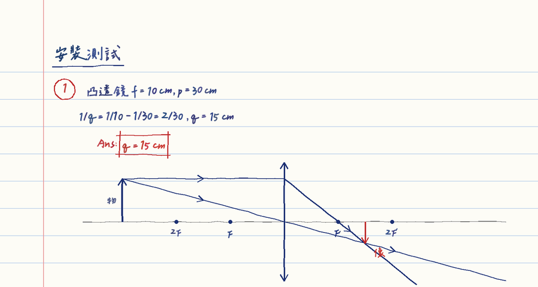

# claude-skills

自己在實際任務裡踩過坑之後整理出來的 [Claude Code](https://claude.com/claude-code) skills。

## web-ship-check：網頁前端上線檢查

改完網頁（HTML／CSS／JS），要跟人說「好了、上線了」之前用。專門處理「對方看到的不是你以為的那一版」：

- 哪些改動存檔就生效、哪些要重啟伺服器（不然畫面會半新半舊）
- Cloudflare 之類 CDN 連 404 都會快取好幾小時 → css／js 加 `?v=` 版本號
- 用 `curl` 看線上實際回應與快取標頭，不要只看本機
- `scripts/page_check.py`：只用 Python 標準庫驅動無頭 Chrome，收集 JS／CSP 錯誤、找出手機寬度下超出畫面的元素、各寬度截圖（不需要 node）
- 手機與 App 內建瀏覽器（微信、LINE）的常見誤判

### 安裝

把 `web-ship-check` 整個資料夾放進 `~/.claude/skills/`（Windows：`%USERPROFILE%\.claude\skills\`），重開 Claude Code 就會出現。

```bash
git clone https://github.com/a0928077807-sudo/claude-skills.git
cp -r claude-skills/web-ship-check ~/.claude/skills/
```

### 單獨用檢查腳本

```bash
python web-ship-check/scripts/page_check.py http://127.0.0.1:8000/ --widths 1280,393,360 --out shots
```

有錯誤或有元素超出畫面時退出碼為 1。找不到 Chrome 時用環境變數 `CHROME` 指定路徑。

## handwritten-notes：手寫筆記 Word 產生器

把習題解答做成「像人手寫」的筆記 Word 檔：橫線筆記紙、藍筆寫過程、紅筆圈題號、紅框標答案。



- 繁中手寫字型（[辰宇落雁體](https://github.com/Chenyu-otf/chenyuluoyan_thin)，OFL 1.1），每個字的大小、角度、位置都隨機抖動，不會像打字
- 支援上標、下標（`10^{-19}`、`q_{1}`），字型缺的符號自動換成手寫時常見的寫法
- 內建面鏡、透鏡光路圖：照比例畫，光線交點就是公式算出的像；也能用手繪線條工具自己畫圖
- 一題盡量不跨頁，太長時在 (b)(c) 小題前換頁

### 安裝

```bash
pip install pillow python-docx fonttools
git clone https://github.com/a0928077807-sudo/claude-skills.git
cp -r claude-skills/handwritten-notes ~/.claude/skills/
```

字型不放在 repo 裡：第一次執行時會自動從原作者的 release 下載（約 9.5 MB），並移除 hinting（不然 Pillow 會出錯），之後就不用再下載。

### 單獨使用

寫一個定義 `NOTES` 的 `content.py`（格式見 [SKILL.md](handwritten-notes/SKILL.md)），然後：

```bash
python handwritten-notes/scripts/hwnotes.py content.py 筆記.docx --png-dir pages
```
